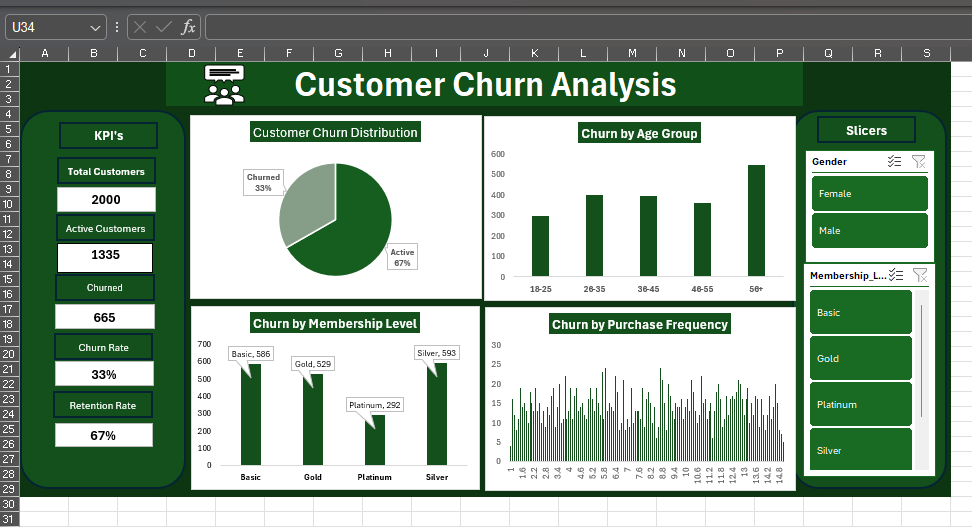
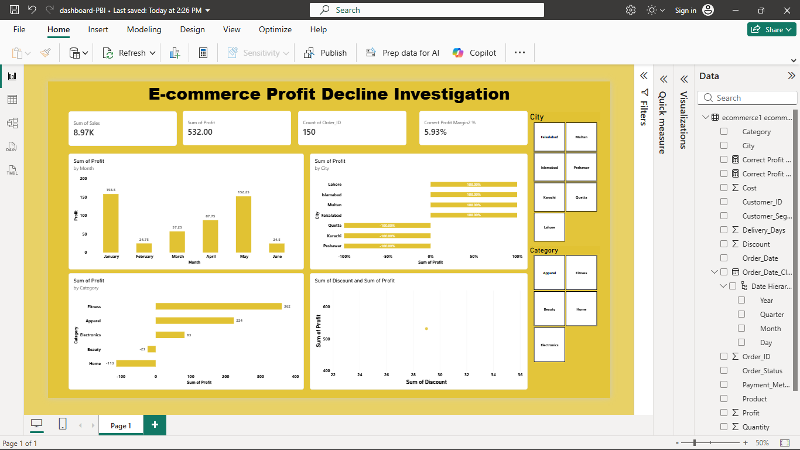
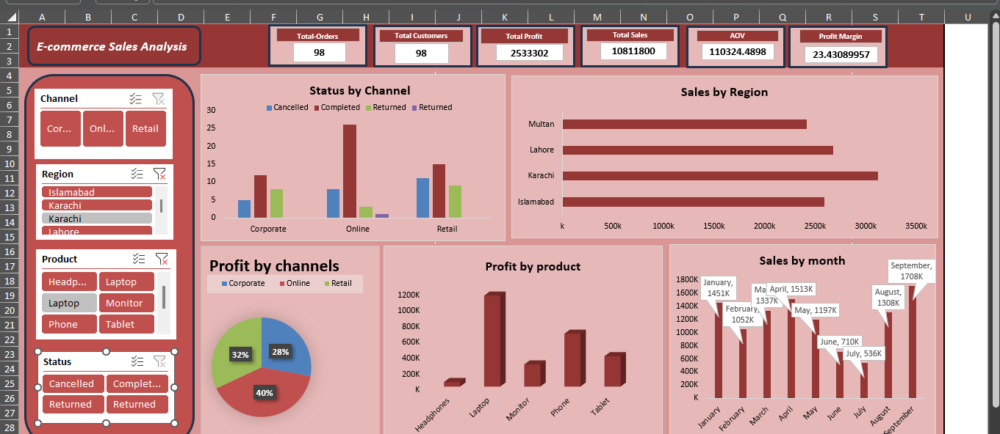
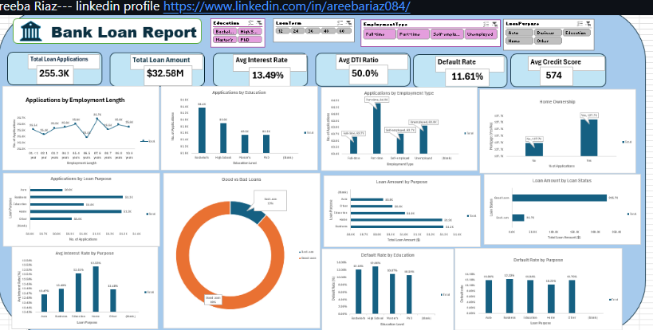

# Areeba Riaz · Data Analyst Portfolio

### Turning data into clear insights and confident decisions.

**Excel · Power BI · SQL · Python**

[Explore the portfolio](index.html) · [Browse the projects](#featured-projects) · [Get in touch](mailto:areeba.riaz@gmail.com)

---

## About

Hi, I’m **Areeba Riaz**, a data analyst who enjoys transforming raw data into useful, easy-to-understand insights. I work across data cleaning, exploratory analysis, dashboard development, and business-focused reporting—with a focus on communicating what the data means, not just what it contains.

This repository includes my portfolio website and selected case studies built with **Microsoft Excel, Power BI, SQL/MySQL, and Python**.

## Featured projects

### 1. Customer Churn Analysis

  

**Excel dashboard · Customer retention**

Analyzed a dataset of 2,000 customers to explore churn across age groups, membership tiers, and purchase frequency. The analysis reports a **33% churn rate** and highlights customer segments that may benefit from targeted retention efforts.

**Focus:** data cleaning · PivotTables · KPI cards · slicers · retention metrics

---

### 2. E-commerce Profit Decline Investigation

  

**Power BI · Profitability analysis**

Investigated why profit was declining despite healthy sales. The dashboard explores margin by product category and city, highlighting loss-making areas and discount-related profit leakage.

**Focus:** Power Query · data modeling · DAX · margin analysis · root-cause analysis

---

### 3. E-commerce Sales Analysis

  

**Excel dashboard · Sales performance**

Compared sales channels, monthly order trends, and regional performance. The analysis also examines profitability and cancellations to surface opportunities to improve channel performance and operations.

**Focus:** PivotCharts · slicers · average order value · trend analysis · category breakdown

---

### 4. Bank Loan Analysis Dashboard

  

**Excel dashboard · Lending and risk**

Built a financial reporting dashboard covering **255.3K loan applications** and **$32.58M in loan volume**. Key indicators include a **50% average debt-to-income ratio** and an **11.61% default rate**.

**Focus:** risk analysis · DTI ratios · nested IF logic · financial reporting · executive dashboard

---

## Portfolio website preview

A few screenshots of the portfolio website are included below. The interactive portfolio itself is available in [`index.html`](index.html).

  
  

  
  

  

## Tools & skills

| Area | Tools and techniques |
| --- | --- |
| Spreadsheets & reporting | Microsoft Excel, PivotTables, PivotCharts, formulas, KPI reporting, slicers |
| Business intelligence | Power BI, Power Query, DAX, data modeling, interactive dashboards |
| Querying | SQL, MySQL, joins, CTEs, subqueries, window functions |
| Data analysis | Python, Pandas, NumPy, Jupyter, exploratory data analysis |

## My analysis workflow

1. **Understand the question** and the decision the analysis should support.
2. **Prepare the data** by checking quality, cleaning, and organizing it.
3. **Analyze the data** to identify trends, comparisons, and potential causes.
4. **Share the findings** through focused visuals, clear takeaways, and practical recommendations.

## Contact

Interested in collaborating or discussing a project?

- **Email:** [areeba.riaz@gmail.com](mailto:areeba.riaz@gmail.com)
- **GitHub:** [github.com/areeba772](https://github.com/areeba772)
- **Location:** Pakistan · Available for remote work

---

*Thanks for visiting — feel free to explore the dashboards and portfolio website.*

